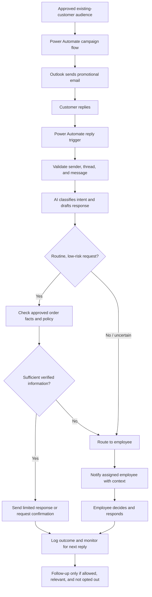

# Architecture and workflow

## Status labels

- **User-described:** A capability stated by the project owner in the available conversation. It has not been independently verified against a flow export or live system.
- **Recommended:** A design element for a safer, more reliable implementation. It must not be represented as already built until verified.
- **To confirm:** An implementation detail not available in the conversation.

## System overview

### User-described components

| Component | Role described | Known implementation detail |
|---|---|---|
| Microsoft Power Automate | Orchestrates promotional sending and email reply processing | Exact flow triggers, actions, and connectors are **To confirm** |
| Outlook | Sends promotional email and receives customer replies | Mailbox type, folders, threading behavior, and permissions are **To confirm** |
| AI agent | Composes promotional content and customer replies; supports follow-ups and routing | Provider, model, prompt, tools, and autonomy settings are **To confirm** |
| Employee | Makes decisions on complex requests after escalation | Notification mechanism, queue, and ownership are **To confirm** |

### Recommended logical flow

The diagram is a **recommended logical design**, not a verified export of the existing Power Automate flows. The owner describes the overall behavior; exact branch ordering and controls remain to confirm.

## Recommended message lifecycle

1. A campaign starts from a permission-checked, current audience list.
2. Power Automate coordinates sending through Outlook. AI content is reviewed against approved offers and brand guidance before campaign use.
3. A customer reply starts the reply workflow. The flow should identify the sender and conversation and avoid processing the same message twice.
4. The AI should classify the request and draft a response using only approved, available facts. Email content is untrusted input.
5. A deterministic policy check decides whether the case is eligible for an automatic response. Uncertainty or sensitive topics go to an employee.
6. A safe response is sent or queued for review according to the configured policy. Follow-ups stop when the customer opts out, the issue is resolved, or an employee takes ownership.
7. The workflow records a minimal operational outcome and exposes failures for employee action.

## Data boundaries

Customer addresses, email bodies, order identifiers, and AI prompts/responses may contain personal or confidential information. **Recommended:** pass only the context needed to answer; avoid sending unnecessary customer/order data to the AI service; do not place secrets in prompts or flow text; restrict run-history access; and define retention and deletion rules.

## Assumptions and open questions

- **Assumption:** the campaign audience consists of existing customers. The source and permission/consent checks are **To confirm**.
- **Assumption:** the reply flow processes only replies, not every incoming message. The exact trigger and filtering are **To confirm**.
- **Assumption:** “normal order request” is a defined low-risk category. Its taxonomy and eligibility conditions are **To confirm**.
- **Assumption:** human employees can receive and act on escalations. The channel, routing rules, and response-time target are **To confirm**.
- **To confirm:** whether follow-ups are campaign follow-ups, customer-service reminders, or both; these should have separate policies and stop conditions.
- **To confirm:** data residency, licensing, connector permissions, mailbox access model, and organization policies.
